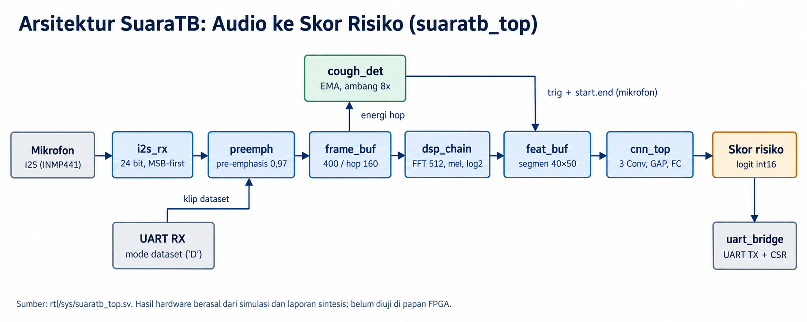

# SuaraTB

Suara batuk berpotensi digunakan sebagai salah satu sumber informasi untuk skrining tuberkulosis (TBC). Namun, membangun model yang bisa mengenali pola dari audio batuk saja tidak cukup. Model tersebut juga perlu diuji pada data yang sesuai, dan implementasinya harus bisa dijalankan pada perangkat dengan sumber daya terbatas.

SuaraTB dikembangkan untuk mengeksplorasi pendekatan tersebut melalui akselerator FPGA. Proyek ini menggabungkan pemrosesan audio, ekstraksi fitur log-mel, dan CNN berkuantisasi int8 untuk menghasilkan skor risiko. Implementasi hardware ditulis dalam SystemVerilog, dengan model referensi di `golden/` sebagai acuan untuk memeriksa kesesuaian hasil komputasi RTL.

Proyek ini dibuat untuk Hackathon Deeptech 2026 - Indonesia Chip Hackathon Challenge, ITB/ICDeC, dengan tema *Medical Device*.

## Cara kerja

Mikrofon I2S mengirim sampel 16 kHz ke `i2s_rx`. Sampel melewati pre-emphasis, dipotong menjadi frame yang saling tumpang tindih,
diberi jendela Hamming, lalu diubah ke spektrum dengan FFT 512 titik dan dipetakan ke 40 band mel. Logaritma diambil dengan tabel
dan hasilnya dikuantisasi ke int8, sehingga satu batuk menjadi segmen fitur berukuran 40x50. Detektor batuk membandingkan energi
tiap hop dengan derau latar yang dilacak (EMA) dan menentukan bagian audio yang diambil.

Segmen itu masuk ke CNN: tiga lapis konvolusi 3x3 dengan ReLU dan MaxPool, lalu GAP dan dua lapis FC yang menghasilkan satu logit.
Akselerator memakai skema output-stationary dengan P lane paralel, dan logitnya dikirim lewat UART. Di sisi perangkat lunak host,
logit dari beberapa batuk dirata-rata dan dapat digabung dengan gejala klinis (`sw/`, belum berisi kode).

Mode mikrofon memakai detektor batuk untuk memilih segmen; mode dataset memproses 50 frame pertama klip yang dikirim lewat UART
(`rtl/sys/suaratb_top.sv`).

Dua keputusan desain yang memengaruhi seluruh repo: setiap blok punya padanan numpy bit-exact di `golden/` yang berfungsi sebagai
spesifikasi, dan RTL dibuat vendor-neutral (tanpa IP atau primitif vendor; kode spesifik perangkat hanya di `target/`). Semua ukuran
(P, lebar data, jumlah kanal) berasal dari `golden/params.py`, sehingga konfigurasi dapat diperkecil untuk FPGA yang lebih kecil.

| Bagian | Nilai |
|---|---|
| Audio | 16 kHz, 16 bit, mikrofon I2S (INMP441), klip 0,5 s |
| Front-end | Pre-emphasis 0,97, frame 400/hop 160, Hamming, FFT 512 radix-2 (data 24 bit), mel 40 band, log2 LUT, int8 |
| Detektor batuk | Energi per hop, EMA derau, ambang 8x, tahan 300 ms |
| CNN | Conv3x3 16/32/32 + ReLU + MaxPool, GAP, FC 32->16->1; 14.496 bobot int8, 3.698.448 MAC |
| Akselerator | Output-stationary, P lane paralel (8/16/32), akumulator 24 bit, requant per layer |
| Antarmuka | I2S masuk, UART keluar (skor) dan mode dataset lewat UART, CSR 8 bit |

## Data

Data audio berasal dari dataset publik Kaggle "Google + CIDRZ Health AI Evaluation Zambia": rekaman batuk di tiga klinik Lusaka
dengan satu perekam dan tiga ponsel, serta metadata klinis 1.828 peserta (205 positif TB). Audio yang dapat dipasangkan dengan label
mencakup 364 peserta (60 positif). Pembagian data selalu per peserta, bukan per klip. Data, audio, fitur, bobot, dan proyek Vivado
disimpan di luar repo (`$SUARATB_DATA`, awal `/data/suaratb`).

## Hasil dan Evaluasi

Ada dua hal yang perlu dibedakan dalam mengevaluasi SuaraTB: apakah implementasi hardware bekerja sesuai model referensi, dan apakah modelnya cukup baik untuk membantu skrining TBC.

Pada sisi hardware, hasil verifikasi menunjukkan bahwa RTL menghasilkan keluaran yang sesuai dengan model referensi pada pengujian yang telah dilakukan. Sintesis untuk target AMD/Xilinx Artix-7 juga menunjukkan bahwa desain dapat mencapai 150 MHz pada konfigurasi yang diuji. Hasil ini berasal dari simulasi dan sintesis, bukan pengujian pada papan FPGA fisik.

Pada sisi model, hasilnya masih terbatas. CNN yang dilatih dari awal menghasilkan AUROC sekitar 0,56, sehingga performanya belum menunjukkan kemampuan diskriminasi yang memadai. Eksperimen menggunakan embedding audio HeAR memberikan hasil yang lebih menjanjikan, tetapi peningkatan performa ketika ditambahkan ke fitur klinis belum meyakinkan. Karena itu, hasil saat ini belum mendukung penggunaan SuaraTB sebagai alat diagnosis maupun klaim bahwa target performa skrining WHO telah terpenuhi.

### Hardware

Vivado 2026.1, Artix-7 XC7A35T-1, out-of-context (tanpa I/O dan MMCM), setelah route, constraint 6,667 ns (150 MHz). Satu kali jalan per P, tanpa seed sweep. Sumber: `docs/vault/sintesis.md`.

| P | LUT | FF | DSP48E1 | BRAM tile | WNS | Daya (vectorless) |
|---|---|---|---|---|---|---|
| 8 | 4.807 (23,1%) | 6.736 (16,2%) | 17 | 12 (24%) | +0,111 ns | 0,168 W |
| 16 | 5.926 (28,5%) | 7.799 (18,8%) | 17 | 12 (24%) | +0,222 ns | 0,192 W |
| 32 | 8.120 (39,0%) | 10.071 (24,2%) | 17 | 12 (24%) | +0,023 ns | 0,246 W |

Pada 100 MHz, ketiga nilai P juga memenuhi timing. Clock inti yang dipakai di `target/` adalah 147,456 MHz (K-22).

Latensi inferensi CNN dihitung dari jumlah siklus hasil simulasi (Icarus, dari `start` sampai `done`) dikali periode clock; ini
angka turunan, bukan laporan alat. Sumber: `docs/vault/sintesis.md`.

| P | Siklus, versi 100 MHz | Latensi @ 100 MHz | Siklus, versi 150 MHz | Latensi @ 150 MHz |
|---|---|---|---|---|
| 8 | 451.851 | 4,52 ms | 451.880 | 3,01 ms |
| 16 | 226.490 | 2,26 ms | 226.520 | 1,51 ms |
| 32 | 122.843 | 1,23 ms | 122.872 | 0,82 ms |

Latensi ini hanya untuk CNN. Waktu yang dirasakan pengguna didominasi pengambilan 0,5 s audio.

### Model audio

| Model | AUROC | Keterangan | Sumber |
|---|---|---|---|
| CNN dilatih dari awal | ~0,56 | Tidak dapat dibedakan dari nol permutasi | `docs/vault/model.md` §4 |
| Embedding HeAR (364 peserta, 60 positif) | 0,71 | Dalam jenis kelamin; p disesuaikan 0,002; referensi sisi host, tidak berjalan di FPGA | `docs/vault/model.md` §5d |
| Distilasi HeAR ke CNN golden | 0,654 | Guru 0,672; penurunan kuantisasi int8 0,008; RTL bit-exact; eksploratori | `docs/vault/model.md` §5e |
| CNN dari awal, kuantisasi int8 | - | Penurunan AUROC 0,001; kriteria <= 0,02 | `docs/vault/model.md` |

### Model klinis

| Model | AUROC | Peserta | Sumber |
|---|---|---|---|
| Gejala klinis saja | 0,77 | 1.828 (205 positif) | `docs/vault/model.md` §5b |
| Tambahan audio HeAR di atas klinis | +0,04 (CI mencakup 0) | 364 (60 positif) | `docs/vault/model.md` §5d |

Standar WHO TPP triase tidak dipenuhi (`docs/vault/model.md` §5c).

### Verifikasi

| Aspek | Hasil | Sumber |
|---|---|---|
| Tes RTL | 20 tes cocotb lulus, simulator Icarus 12 (regresi 2026-10-12) | `docs/vault/status-fase.md` |
| Tes golden | 67 tes lulus | `docs/vault/status-fase.md` |
| Kesesuaian RTL dengan golden | Bit-exact per modul dan ujung ke ujung, mode dataset dan mikrofon | `docs/vault/verifikasi.md` |
| Konfigurasi diuji | P = 8, 16, 32; bobot acak terkalibrasi, `model_v2`, dan bobot distilasi | `docs/vault/verifikasi.md`, K-23 |

Laporan lengkap ada di `docs/result/result.md` (dan `report.pdf`).

## Keterbatasan

- SuaraTB dimaksudkan untuk mendukung triase dan prioritas rujukan ke pemeriksaan lanjutan, bukan untuk mendiagnosis TBC.
- Target WHO untuk triase (sensitivitas minimal 90% dan spesifisitas minimal 70%) belum terpenuhi.
- Desain belum diuji di papan FPGA. Jenis papan di lokasi acara belum diumumkan (Fase 7).
- Evaluasi audio memakai satu dataset dari tiga klinik dengan 364 peserta berlabel (60 positif); tidak ada klaim generalisasi.
- Syarat tambahan dataset (di luar ODbL-1.0 dari metadata Kaggle) belum dibaca, dan bobot model tidak ada di repo.

## Status

Fase 0 sampai 6 selesai, termasuk versi 150 MHz (cabang `optimized`) dan remodeling model. Fase T (regresi terpadu) lulus di
simulasi. Sisanya: papan FPGA (Fase 7, bila diumumkan) dan benchmark CPU (Fase 8). Rincian di `docs/vault/status-fase.md`.

## Struktur repo

| Jalur | Isi |
|---|---|
| `golden/` | Spesifikasi: model numpy bit-exact, parameter beku (`params.py`), pembangkit tabel/vektor/anggaran, tes golden |
| `rtl/` | SystemVerilog vendor-neutral: audio, detektor batuk, DSP, CNN, sistem (UART, CSR, top) |
| `tb/` | Testbench cocotb per modul dan ujung ke ujung, vektor uji sintetis dari golden |
| `target/` | Satu-satunya kode spesifik perangkat: skrip sintesis Vivado (Artix-7) dan Yosys |
| `model/` | Data, pelatihan, evaluasi, embedding pralatih, distilasi, ekspor bobot int8 |
| `sw/` | Penampung perangkat lunak host (fusi klinis, benchmark, aplikasi demo); belum berisi kode |
| `docs/` | Konteks proyek (`vault/`), keputusan, dan laporan hasil (`result/`) |

Setiap direktori punya `README.md` sendiri.

## Dokumen

Baca berurutan: `docs/vault/status-fase.md`, `docs/vault/spesifikasi.md`, `docs/vault/keputusan.md`. Indeks: `docs/CONTEXT_INDEX.md`.
Perintah build dan tes ada di `Makefile` (`make help`) dan docstring skrip; README tidak mengulangnya.

## Referensi

- Dataset: [Google + CIDRZ Health AI Evaluation Zambia di Kaggle](https://www.kaggle.com/datasets/googlehealthai/google-health-ai)
- Model embedding akustik: [HeAR (`google/hear-pytorch`) di Hugging Face](https://huggingface.co/google/hear-pytorch)
- Pembanding embedding: OPERA (OPERA-CE dan OPERA-CT); tautan belum dicantumkan karena belum diverifikasi.

## Lisensi

Lihat `LICENSE`. Data Zambia CIDRZ (ODbL-1.0) dan TBscreen (CC BY 4.0) tidak didistribusikan di repo ini.
